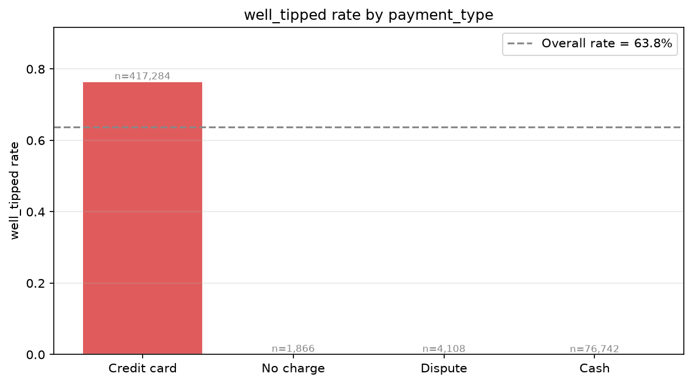
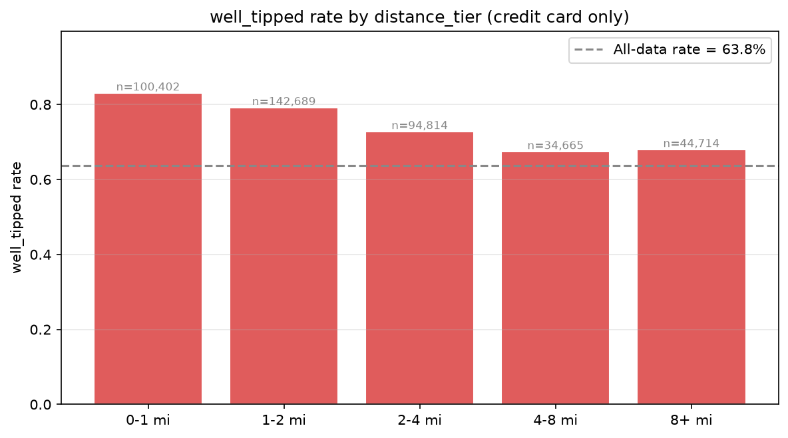
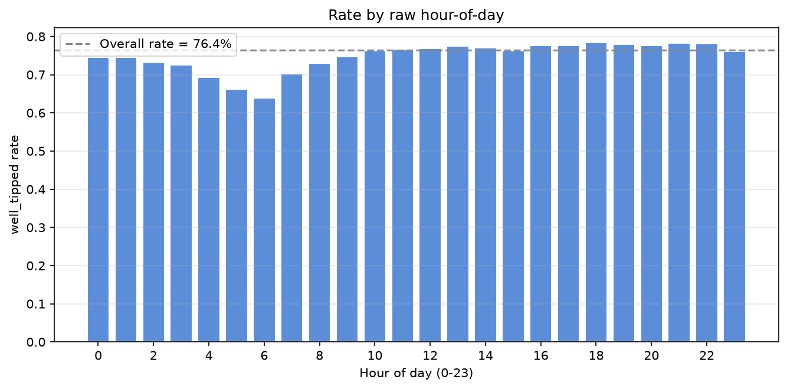
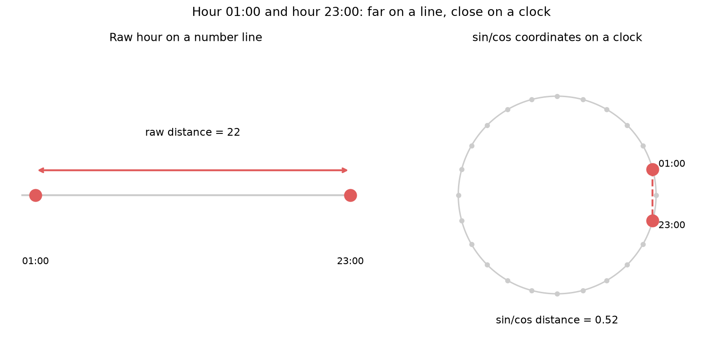
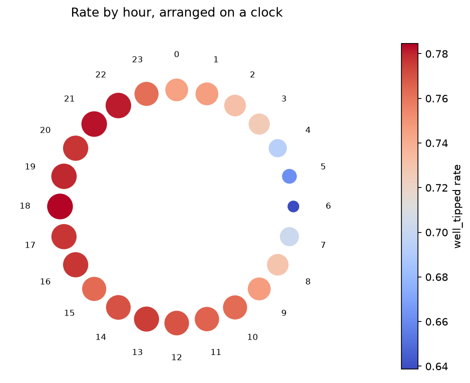

# Data Science stuff I wish I knew sooner: Categorical and Time Signals

Two feature types get mishandled more often than any other: categories and timestamps. Both
tend to get dumped into a model as-is, a category one-hot-encoded without ever checking
whether it says anything, a timestamp fed in as a raw number without asking whether that
number's notion of "distance" makes any sense. This article is about looking before
encoding: one plot that tells you whether a category is worth the trouble, and one fix for
a specific, common way a time feature actively misleads a model.

For categories, the question is the same whether the category has a natural order or not:
does the label's average rate move across categories, or is it flat? For time, the problem
is narrower and more mechanical: a raw hour-of-day feature (0-23) treats hour 23 and hour 0
as nearly as far apart as two hours can be, when on an actual clock they're an hour apart.
Sine and cosine fix that by mapping the hour onto a circle instead of a line.

The companion notebook
[`6-Categorical-and-Time-Signals.ipynb`](6-Categorical-and-Time-Signals.ipynb) works through
both ideas on a real, unmodified dataset — no synthetic labels this time, every signal
below is something the data actually does. **Target encoding**, the natural next step once
a categorical signal is confirmed, is deliberately left out and gets its own article later;
this one stops at seeing and understanding the signal.

---

## Dataset

[NYC Yellow Taxi Trip Records](https://www.nyc.gov/site/tlc/about/tlc-trip-record-data.page),
January 2024 — published directly by the NYC Taxi & Limousine Commission as a public
Parquet file, no account or API key required. One month is roughly 2.9 million trips with a
pickup timestamp, a payment method, a passenger count, a trip distance, and the fare and
tip amounts actually charged.

There is no pre-built label here. Three things are derived from real columns, nothing is
invented:

* **`well_tipped`** — 1 if the tip was at least 20% of the fare. This only means something
  for credit-card trips: cash tips are essentially never logged by the metering system, so
  a cash trip shows a $0 tip whether or not cash actually changed hands. That quirk is the
  first signal worth seeing below, not a data-quality problem to clean away.
* **`distance_tier`** — `trip_distance` bucketed into 5 ordered bands, `0-1 mi` through
  `8+ mi`. Binning a continuous variable into ordered bands like this is a completely
  standard way to *get* an ordinal categorical column in the first place.
* **`hour`** — the pickup hour, 0 through 23.

150,000 rows are sampled (fixed seed) out of the ~2.9 million, large enough to keep every
hour-of-day bucket stable even overnight, when trip volume is naturally low. Sampling is
the only randomised step in this article.

---

## 1. A nominal category: `payment_type`

`payment_type` has no natural order — Credit card, Cash, Dispute, No charge are just four
different ways a trip got paid for. With no order to preserve, the bars are sorted by rate
instead.



```python
plotter.plot_category_rate(df, category_col="payment_type", label_col="well_tipped")
```

This is about as strong a categorical signal gets: credit-card trips are "well tipped" 76%
of the time, every other payment method sits at essentially 0%. Before reading that as
"cash riders don't tip", remember how the label was built — cash tips are invisible to the
system that generated this dataset, so a cash trip and a genuinely untipped credit-card
trip are recorded identically. The signal is completely real and completely usable, it just
reflects *how the label gets recorded* as much as it reflects rider behaviour. A strong
categorical signal is not automatically a strong causal one, and it's worth asking why
before building on top of one.

Because payment type dominates this hard, the sections below condition on
`payment_type == "Credit card"` throughout, otherwise this one column would drown out every
other signal in the data.

---

## 2. An ordinal category: `distance_tier`

`distance_tier` does have a natural order, short trips to long trips, and that order is
exactly what the plot should preserve — passing an explicit `order` keeps the bars in
sequence instead of sorting by rate, because a trend *along* that order is the whole reason
to look.



```python
plotter.plot_category_rate(
    credit_card_df, category_col="distance_tier", label_col="well_tipped",
    order=["0-1 mi", "1-2 mi", "2-4 mi", "4-8 mi", "8+ mi"],
)
```

A clean downward trend for the first four bands: short trips get tipped generously, longer
trips less so. That matches well-documented tipping behaviour outside taxis too — riders
anchor on a roughly fixed dollar amount rather than scaling the tip with the bill, so the
percentage shrinks as the bill grows. The `8+ mi` band breaks the pattern and ticks back up,
plausibly airport and other flat-rate trips in that bucket, where a different, more generous
tipping norm applies. A real ordinal signal doesn't have to be perfectly monotonic to be
worth using, but a break in the trend like this is worth explaining, not silently averaged
away.

Both signals above are exactly what a model would want to exploit, and exactly what target
encoding turns into a safe numeric feature. That's a big enough topic for its own article —
this one stops at confirming the signal exists.

---

## 3. A time column, the naive way

`hour` looks like an ordinary numeric feature, 0 through 23, so the natural first move is to
plot the label's rate against it directly.



There's a real pattern: a dip in the early morning (lowest around 6 AM) and a plateau
through the afternoon and evening. But look at the two ends of the chart — hour 23 and hour
0 sit at opposite edges, as far apart as two bars can be, despite being one hour apart on an
actual clock. Anything a model learns "at the edges" of this feature, a threshold, a linear
trend, a tree split, treats 23 and 0 as maximally different when they're actually adjacent.
A raw hour feature lies about distance.

---

## 4. Fixing the distance: sine and cosine

The fix is to stop representing "hour" as a position on a line and represent it as a
position on a *circle* instead, exactly like a clock face. Map each hour to an angle around
the circle, then read off that angle's `(cos, sin)` coordinates:

```python
angle = 2 * pi * hour / 24
hour_sin = sin(angle)
hour_cos = cos(angle)
```

Two hours that are close on the clock, like 23:00 and 01:00, land close together in
`(hour_sin, hour_cos)` space too, because they *are* close together on the circle the
formula is built from. Hour 0 and hour 12, the two times as far apart as a 24-hour clock
allows, land on opposite sides of the circle. This isn't a trick, it's just plotting the
hour where a clock already puts it.



Left: 1:00 and 23:00 on a plain number line, 22 apart, nearly the two most distant points
the raw feature can take. Right: the same two hours placed on a clock by their `(cos, sin)`
coordinates, visibly a short arc apart. Same two timestamps, two different stories about how
far apart they are — only one of them matches the calendar.

```python
hour_distance(1, 23)   # raw = 22,  sin/cos = 0.52
hour_distance(0, 12)   # raw = 12,  sin/cos = 2.00  (truly opposite)
hour_distance(9, 17)   # raw =  8,  sin/cos = 1.73  (an ordinary 8h gap)
```

1 and 23 are 22 apart on the raw feature, worse than almost any other pair on a 24-hour
clock, but only 0.52 apart in `(sin, cos)` space — among the closest pairs possible, which
matches how close 1 AM and 11 PM actually are. 0 and 12, truly opposite ends of the day, get
the largest possible cyclical distance (2.0), while the raw feature only ranks that pair as
moderately far apart. 9 and 17, a genuinely ordinary 8-hour gap, land in between on both
scales — raw and cyclical distance agree once two hours are far enough apart that
wraparound isn't the deciding factor. Wraparound is the whole issue, and it only bites near
the boundary.

Now the same rates from Section 3, arranged on the clock they actually describe:



The early-morning dip and the daytime plateau are the same pattern as the bar chart, but now
hour 23 and hour 0 sit next to each other, because they *are* next to each other. The
gradual colour change all the way around the circle, rather than a hard seam at midnight, is
what a well-behaved cyclical feature should look like — and it's exactly what
`hour_sin` / `hour_cos` hands to a model instead of the raw hour column.

---

## What to do about it

1. **Plot the category rate before encoding anything.** One bar chart tells you whether a
   category has signal at all. Flat bars mean the category has little to offer regardless of
   how it gets encoded downstream.
2. **Preserve order for ordinal categories, sort by rate for nominal ones.** The plot's job
   is different in each case: reveal a trend along a meaningful order, or rank categories
   that have none.
3. **A strong signal isn't automatically a causal one.** `payment_type` here is a textbook
   case: the effect is real and usable, but it partly reflects how the label was measured,
   not just how riders behave. Ask why before trusting the story a bar chart seems to tell.
4. **Any wraparound time feature needs sine/cosine, not just hour-of-day.** Day-of-week,
   day-of-year, month-of-year, compass bearing, all have the same problem at their
   boundaries, and the same fix.
5. **Test is simple: are the two ends of the range actually adjacent in reality?** If yes,
   the raw numeric encoding is wrong for that column, no amount of model complexity fixes it
   on its own.

---

## Running the notebook

```bash
cd 6-categorical-and-time-signals
uv sync
uv run jupyter notebook
```

Or in VS Code: open `6-Categorical-and-Time-Signals.ipynb` and select the `.venv` kernel.

---

## References

- [NYC TLC Trip Record Data](https://www.nyc.gov/site/tlc/about/tlc-trip-record-data.page)
- [scikit-learn — Time-related feature engineering](https://scikit-learn.org/stable/auto_examples/applications/plot_cyclical_feature_engineering.html)
